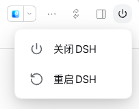
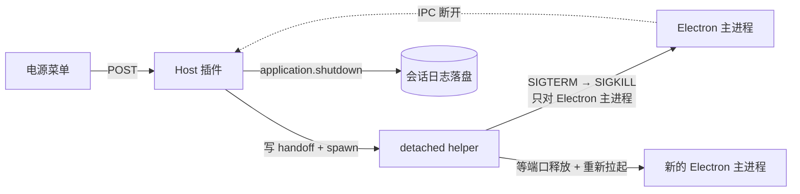

# dsh-power-menu-mac

给 DeepSeek Harness 桌面版（**macOS**）加一个右上角电源按钮：点开有 **刷新页面**、**重启DSH**、**定时…**、**关闭DSH** 四项，省得每次改完插件/配置还要去菜单栏里翻「退出」——多数时候你要的只是刷新，不必重启。

> macOS 专用 · 只支持 DSH Desktop · 纯本地 · 无外部依赖 · MIT
>
> 这是 [xichen-62/dsh-power-menu](https://github.com/xichen-62/dsh-power-menu)（Windows 版）的 **macOS 移植**，按 MIT 许可独立发布。原版的版权与思路保留在 [LICENSE](LICENSE) 和 [致谢](#致谢) 里。



## 为什么做这个

DSH Desktop 关窗口只是收进 Dock，真正退出或重启要走菜单栏；而改插件、改配置之后又经常需要重启一次。这个插件把这两步搬到会话标题栏右上角：一个电源键，两项操作，点完就走。

原版只支持 Windows —— 它靠 `taskkill` 结束进程、靠 PowerShell 读进程表和窗口句柄。macOS 上这些都没有，所以这里把它们换成了 POSIX 的做法，并且**顺手补上了原版在 Mac 上做不到的那件事**（见下面「重启是怎么验证成功的」）。

## 功能

- **右上角电源按钮**：位于会话标题栏图标行最右侧，顺序为「布局 / 侧栏 / 电源」。
- **空会话也显示**：欢迎页和对话内使用同一个挂载位置，透明无底色，不会破坏主题，也不会出现两个按钮。
- **四项操作**：白色圆角卡片、悬浮阴影、左侧线性图标 + 右侧文本，不塞多余入口；按破坏性从小到大排，误触最多落到「刷新页面」。
- **刷新页面**：只重载这一层页面，应用和 Host 都不动。改完插件/配置用它，别再用重启代替刷新。
- **重启DSH**：结束整个应用，等旧端口释放后用原可执行文件重新拉起，窗口自动回来。
- **定时…**：点开一个居中的弹窗，先填分钟数，再从三种里选一种 ——「N 分钟后关闭」（到点才关，期间照常用）、「N 分钟后重启」（到点关掉再开）、「现在关闭，N 分钟后启动」（立刻关，过一会儿自己回来）。弹窗会显示换算出的执行时刻，打开时焦点已在输入框里、直接打字就能改；有定时在等的时候，弹窗里多一行「取消已设定的定时」。Esc 或点背景关闭。
- **关闭DSH**：结束整个 DeepSeek Harness 桌面应用（Electron 主进程 + Host），不重新启动。
- **重启会验证真的回来了**：新进程必须**注册到 macOS 窗口服务器**（`lsappinfo`）并活过启动宽限期，才算成功；只是「进程还在」不算。
- **键盘可用**：`↑` / `↓` / `Home` / `End` 在四项间移动，`Enter` / 空格执行，`Esc` 关闭，点菜单外部也能关。
- **执行反馈**：点击后整页盖一层半透明遮罩，显示「正在关闭DSH…」/「正在重启DSH…」。
- **有配置页**：插件管理页里这一行带一个配置控件，打开就是自己的页面（`#/panel/plugins/dsh-power-menu-mac/dsh-power-menu-mac`）。分钟数、提示词开关、自定义文本都在里面，改完点保存才写入。
- **顺带管住模型的嘴**：插件会向系统提示词注入一句「DSH 的重启与关闭由用户自己通过电源菜单完成，不要询问也不要主动提议」。装了电源菜单的人自己两下就点完了，模型再问一轮只是废话。**只在桌面宿主生效**——`dsh web` 上没有这个按钮，那段话会整段丢弃，不会给出错误指引。
- **纯本地**：没有外部依赖、没有遥测；接口只监听本机回环地址，并做同源校验。
- **非 macOS 不加载**：宿主半只说 POSIX，所以在别的系统上按钮**根本不会画出来**，而不是画出来点了没反应。

## 安装

> **重要**：装完插件后，必须再运行一次 `enable.sh`（或直接用下面的 `install.sh`），把 `dsh-power-menu-mac` 补进 profile 的 `dsh.profile.bundles`，然后重启 DSH。少了这一步，按钮会 404 —— 这是 DSH 插件管理器只写 `dependencies`、不写 bundles 的已知行为，不是插件本身的问题。

### 方式 A：一键脚本（推荐）

```bash
git clone https://github.com/DDDMUC/dsh-power-menu-mac.git
cd dsh-power-menu-mac
./install.sh
```

脚本会：找到 DSH 自带的 `dsh` CLI → 安装插件（有 `git` 用 `github:` 依赖，没有就下载 Release 里的 `.tgz`）→ 补齐 `dsh.profile.bundles` → 提示重启。

GitHub 直连慢或不通时：

```bash
./install.sh --mirror
```

完全离线：

```bash
./install.sh --tgz ./dsh-power-menu-mac-0.1.0.tgz
```

> `dsh` 不在 `PATH` 上也没关系 —— 脚本会去 `.app` 包里找：
> `/Applications/DeepSeek Harness.app/Contents/Resources/runtime/cli/bin/dsh`。

### 方式 B：通过 DSH 插件管理器

1. 打开 DSH Desktop 的 **插件 / 插件市场**。
2. 选择 **添加插件**，输入：

   ```text
   github:DDDMUC/dsh-power-menu-mac
   ```

3. 安装完成后，补一次 bundles（这一步不能省）：

   ```bash
   ./enable.sh
   ```

4. 重启 DSH，并在 **插件市场 → 已安装** 里确认 `dsh-power-menu-mac` 处于「启用中」。

### 方式 C：命令行安装

```bash
"/Applications/DeepSeek Harness.app/Contents/Resources/runtime/cli/bin/dsh" \
  plugin --profile desktop add github:DDDMUC/dsh-power-menu-mac
./enable.sh
```

### 方式 D：本地开发安装

```bash
git clone https://github.com/DDDMUC/dsh-power-menu-mac.git
ln -s "$PWD/dsh-power-menu-mac" ~/.dsh/profiles/desktop/node_modules/dsh-power-menu-mac
```

然后在 `~/.dsh/profiles/desktop/package.json` 里：

- `dependencies` 增加 `"dsh-power-menu-mac": "link:<你 clone 下来的目录>"`
- `dsh.profile.bundles` 增加 `"dsh-power-menu-mac"`

（或者直接跑 `./enable.sh desktop` 帮你改 bundles。）

重启 DSH 生效。这个插件没有构建步骤，改完 `lib/` 里的文件重启即可。

## 使用

1. 在会话标题栏右上角点电源图标。
2. 选择 **刷新页面**、**重启DSH**、**定时…** 或 **关闭DSH**。
3. 刷新会立刻重载界面；关闭会退出应用；重启会在几秒后把窗口拉回来（后两者才有遮罩）。

| 动作 | 结果 | 需要手动重开？ |
| --- | --- | --- |
| 刷新页面 | 只重载渲染层，应用与 Host 继续运行 | 否，界面自己回来 |
| 重启DSH | 结束应用 → 等端口释放 → 重新拉起 → 验证窗口 | 否，窗口自动回来 |
| N 分钟后关闭 | 什么都不做 → 到点优雅关闭 → 清 cookie | 是 |
| N 分钟后重启 | 什么都不做 → 到点关闭 → 清 cookie → 重新拉起 | 否，到点自己回来 |
| 现在关闭，N 分钟后启动 | 立刻关闭 → 清 cookie → 等 N 分钟 → 重新拉起 | 否，到点自己回来 |
| 关闭DSH | 结束整个桌面应用，不重新启动 | 是 |

> **注意**：点击即执行，没有二次确认。重启和关闭都会中断正在生成的回答、运行中的工具和后台任务，请在点之前保存手头的事情；**刷新不会中断任务**，它只重载界面，后台照常跑。

> **改完插件代码要重启，别用刷新。** 刷新只重载页面，不会重新加载插件的客户端 bundle。而 DSH 的 bundle 是按 revision 发布的——磁盘上的文件一变，宿主算出的 revision 就跟页面手里那个对不上，请求会被**直接拒绝**（`dsh-client-modules` 的原话：*Versioned code is immutable; mismatched revisions are rejected instead of serving newer bytes*），表现为整组插件一起 `bundle script … failed to load`。刷新按钮是给「没改代码、只想重载界面」用的。

## 配置

**在插件管理页里改**：插件列表 → `dsh-power-menu-mac` → 组件行右侧的**配置**控件 → `#/panel/plugins/dsh-power-menu-mac/dsh-power-menu-mac`。里面有分钟数、提示词开关和自定义文本框，点「保存」才写入。

也可以直接改文件 `~/.dsh/dsh-power-menu-mac/config.json`，第一次读取时会自动生成：

```json
{
  "delayedRestartMinutes": 10,
  "restartGuidance": true,
  "restartGuidanceText": ""
}
```

| 字段 | 作用 | 合法值 |
| --- | --- | --- |
| `delayedRestartMinutes` | 定时弹窗输入框的**默认**分钟数 | 1–1440 的整数；小数、0、负数、超过 1440、字符串一律回落 10 |
| `restartGuidance` | 是否注入下面那段系统提示词 | 只有显式 `false` 才关；缺省或写错类型都当开 |
| `restartGuidanceText` | 提示词正文 | 界面里预填默认那句；与默认一字不差时存为空串（＝继续跟随默认，以后默认改了能跟上）；超过 2000 字截断 |

改完**打开一次菜单**就生效（提示词是下一个请求生效），都不用重启应用。弹窗里每次都能临时改数字，`delayedRestartMinutes` 只决定默认值。

老版本的配置文件只有 `delayedRestartMinutes`，缺的两个字段会走默认行为，不需要迁移。

## 注入的系统提示词

本插件声明了 `systemPrompt` 依赖，并在 `apply` 里注册一段全局提示词：

```
DSH 桌面应用的重启与关闭由用户自己通过界面右上角的电源菜单完成。
不要询问用户是否需要重启或关闭 DSH，也不要主动提议这样做。
```

三点说明：

- **只在桌面宿主渲染**。`text` 是个函数，非桌面宿主（`dsh web`）返回空串，空段落会被整段丢掉——那里没有电源菜单，说"用户自己点"是错误指引。
- **范围刻意写窄**。没有写成「不要问用户」，那样会连带压住改文件、跑命令之类的正常询问。
- **它是全局的**。所有会话、所有 preset 都会看到。哪天你想让模型帮你重启，这句会压住它——用 `dsh plugin` 停用本插件即可恢复。
- **可以关，也可以换掉**。`config.json` 里 `restartGuidance: false` 就不注入；`restartGuidanceText` 填一段自己的话就替换掉默认文本（上限 2000 字，超了截断并在日志里记一笔）。改完下一个请求就生效。

## 工作原理

桌面版的进程树大致是：

```text
Electron 主进程
└── Host 子进程（dsh-desktop-host，ELECTRON_RUN_AS_NODE=1）
    └── 本插件
```

插件跑在 Host 里，不能直接调用 Electron 的 `app.quit()` / `app.relaunch()`。所以 Host 只负责"交接"，真正的进程切换交给一个分离的 helper：



具体步骤：

1. Host 把交接信息写到 `~/.dsh/dsh-power-menu-mac/`，用 `process.execPath` + `ELECTRON_RUN_AS_NODE=1` 启动 `lib/helper.cjs`。
2. helper 等 1.2 秒，让 HTTP 应答先到浏览器。
3. helper 对 Electron 主进程发 `SIGTERM`（让它有机会收尾），必要时 `SIGKILL`。**只对主进程**，不碰它的子树。
4. Host 检测到断开后走自己的 `application.shutdown`，尽量把会话日志正常落盘。
5. 重启模式下，helper 等旧监听端口释放，清掉 `ELECTRON_RUN_AS_NODE` / `DSH_DESKTOP_NODE_EXECUTABLE`，用原可执行文件重新拉起，**并验证新进程真的注册到了窗口服务器**；失败会重试，仍失败就弹窗提示手动打开。
6. 关闭模式下不拉起，等 Host 自己退出。

### 重启是怎么验证成功的

这是 macOS 版和原版行为差别最大的地方。

原版在 Windows 上用 `Get-Process` 读 `MainWindowHandle` / `MainWindowTitle`，能真的看到窗口，还能认出「应用无法启动」这类崩溃对话框。macOS 上作者没有对应手段，只能退化成**"进程还活着就算成功"** —— 白屏、卡在启动、崩溃循环都会被误判成成功。

这里的做法是查窗口服务器：

```bash
lsappinfo find pid=<新进程>
```

- 有输出 → 这个进程**已经作为 GUI 应用注册到窗口服务器**，有界面了。
- 空输出 → 进程在跑，但从来没连上窗口服务器（崩溃循环、headless 重启）。
- 之后再要求它活过启动宽限期（单实例锁意味着第二个实例会立刻退出，活下来就说明是它）。

`lsappinfo` 是 macOS 自带、**不需要任何权限**。另一条路（`osascript` + System Events 查窗口）需要辅助功能授权，会在用户面前弹一个同意框 —— 而这个框恰好出现在"应用刚重启失败"的时候，非常糟糕，所以没用。

### 接口

Host 半注册四个仅限本机回环的接口：

```text
POST /api/dsh-power-menu-mac/shutdown
POST /api/dsh-power-menu-mac/restart
GET  /api/dsh-power-menu-mac/health
GET  /api/dsh-power-menu-mac/plan
```

## 安全

- 四个接口只接受回环地址（`127.0.0.1` / `::1`），校验 `Host` 必须是本机，拒绝 `sec-fetch-site: cross-site`，带 `Origin` 时必须与本机同源。
- 没有鉴权令牌的第三方网页无法跨站触发关机/重启。
- 只支持桌面版；`dsh web` 下接口返回 409，不会去杀别的进程。
- 关机/重启时只清理**本应用自己的进程**（Electron 主进程的渲染/GPU/工具子进程）。宿主（`dsh` host）在 DSH 终端里被启动的其它子进程——第二个 `dsh web` 实例、dev server、构建任务——**默认不碰**；需要旧行为时设 `DSH_POWER_MENU_KILL_HOST_CHILDREN=1`。
- 重启会沿用当前实例的启动参数（按 home 读取 `<DSH_HOME>/power-menu-relaunch-args.json`），所以用 `--user-data-dir` 启动的隔离 home 不会在重启后掉回默认 Electron profile。
- 不收集任何数据，不联网；日志只写在本地 `~/.dsh/dsh-power-menu-mac/`。

## 兼容性

- **系统**：macOS。插件依赖 `ps` / `kill` / `lsappinfo`，Windows 和 Linux 未实现（`package.json` 里 `os: ["darwin"]`，装到别的系统上会直接拒绝）。
- **DSH**：在 **DSH Desktop 0.2.1-rc.3** 上实测通过（2026-10-26）。
- **Node**：跟随 DSH 自带的 Node（22+），无需单独安装。

## 开发

```text
dsh-power-menu-mac/
├── lib/
│   ├── index.js        Host 半：四个回环接口 + 交接调度
│   ├── client.js       浏览器半：window.__ModuleLoader__ bundle
│   └── helper.cjs      分离的交接 helper
├── install.sh          一键安装
├── enable.sh           补 dsh.profile.bundles
├── cordis.patch.yml    bundle 插入层
├── package.json
├── docs/screenshot.png
└── README.md
```

- 客户端 bundle 不是普通 ESM，必须用 `window.__ModuleLoader__.load({ id, factory })` 格式；`dsh.client.inject` 声明 `@deepseek-ai/dsh-client-ui-slots`。
- 没有构建步骤，也没有运行时 npm 依赖。
- 提交前跑一次静态检查：

  ```bash
  npm run check
  ```

- 本地调试日志：`~/.dsh/dsh-power-menu-mac/power-menu.log` 和 `helper-*.log`。

## 常见问题

**按钮没出现？**
确认插件处于「启用中」，并重启过一次 DSH；按钮只出现在有会话标题栏的页面。如果是在 Windows 上，按钮**本来就不该出现** —— 请用原版 [dsh-power-menu](https://github.com/xichen-62/dsh-power-menu)。

**点了没反应 / 报 409？**
`dsh web`（浏览器里的 Web 版）不支持，只支持桌面版。看 `~/.dsh/dsh-power-menu-mac/` 下的日志。

**重启后端口变了？**
正常。DSH Desktop 每次启动用随机端口（`--port 0`），插件只负责拉起新实例，不假设端口不变。

**DSH 装在中文路径 / 用户名含中文能用吗？**
可以。插件不拼 shell 字符串：启动用 `spawn(exe, [], { cwd })`，路径作为单个 argv 交给 Node 的 Unicode API；交接 JSON 和日志按 UTF-8 读写。helper 自带 `--pathtest`，会在「中文 + 空格」的临时目录里实测 UTF-8 读写和从中文路径启动脚本。

**装完点按钮报 `HTTP 404`？**
说明宿主半没加载：插件只在 `dependencies` 里，不在 `dsh.profile.bundles` 里。跑 `./enable.sh`，或手动把 `dsh-power-menu-mac` 加进 profile 的 `dsh.profile.bundles`，再重启 DSH。

**为什么按钮不挂真实 slot？**
DSH 的 `conversation.session.header.corner` 是单占用槽，已经被侧栏开关占用；`conversation.session.header.utilities` 会排在侧栏左侧；`sidebar.footer.action` 在左下角。要在不修改 DSH 的前提下保持右上角，只能把按钮挂进 `headerCorner` 的 DOM。代价是上游改头部结构时可能失效；插件用 `MutationObserver` 跟随，不轮询。

**关闭/重启会跳过 profile 收尾吗？**
会有一点：插件只结束 Electron 主进程，Host 会走 `application.shutdown`，但主进程的 `before-quit` 可能被跳过，Chromium 的 Cookie / Local Storage 不保证落盘。追求最干净的退出请用菜单栏的「退出」。真正的 `app.quit()` 需要 DSH 提供协作退出 IPC，插件单方面做不到。

## 卸载

- 插件管理器里移除 `dsh-power-menu-mac`，或者从 profile 的 `dependencies` / `dsh.profile.bundles` 里删掉，再删掉 `node_modules` 里的链接。
- 可选：删除 `~/.dsh/dsh-power-menu-mac/` 下的日志与交接文件。
- 重启 DSH 生效。

## 更新日志

见 [CHANGELOG.md](CHANGELOG.md)。

## 许可证

[MIT](LICENSE) © 2026 DDDMUC（macOS 移植）· © 2026 xichen-62（原版 dsh-power-menu）

## 致谢

- 原版 [xichen-62/dsh-power-menu](https://github.com/xichen-62/dsh-power-menu)（MIT）：整体结构、客户端界面、菜单交互、安全边界都来自它，本项目只是把宿主侧的进程操作换成了 POSIX 的做法。截图也沿用原版。
- 分离 helper 做进程交接、只结束主进程让 Host 优雅退出的思路，原版参考了 [dsh-desktop-restart](https://github.com/luoshuizhiwei/dsh-desktop-restart)（MIT）。
- 菜单样式参考 Windows 电源菜单；图标为内联 SVG，无第三方图标库。

---

## English

A macOS port of [dsh-power-menu](https://github.com/xichen-62/dsh-power-menu) (MIT). Adds a power button to the top-right of the DSH Desktop session header with three actions, least destructive first:

- **刷新页面** — reload the renderer only; the app and its Host keep running, so this replaces the usual "restart just to refresh" habit.
- **重启DSH** — quit and relaunch the app, so the window comes back automatically.
- **定时…** — a panel: pick minutes, then 关闭 after N / 重启 after N / quit now and come back after N. A waiting schedule can be cancelled from the same panel.
- **关闭DSH** — quit the whole desktop app (no relaunch).

The Windows build drove `taskkill` and PowerShell; this one drives POSIX `ps` / `kill` / `lsappinfo`. The meaningful difference: a restart is only reported as successful once the new process has **registered with the macOS window server** (`lsappinfo find pid=…`) and survived its startup grace — "the process is still alive" is not accepted as proof, which is all the original could check on macOS.

macOS only (`os: ["darwin"]`), DSH Desktop only. No telemetry, no external dependencies; the four HTTP routes are loopback-only and same-origin fenced.

```bash
git clone https://github.com/DDDMUC/dsh-power-menu-mac.git
cd dsh-power-menu-mac
./install.sh
```

Or add `github:DDDMUC/dsh-power-menu-mac` in the DSH plugin manager, then run `./enable.sh` and restart DSH.

MIT licensed, retaining the original copyright.
